# Camera architecture and protocol boundaries

## Hardware and processor ownership

The project targets AMD `xczu2cg-sfvc784-1-e` on the
[ALINX AXU2CGB board](https://www.en.alinx.com/Product/SoC-Development-Boards/Zynq-UltraScale-plus-MPSoC/AXU2CGB.html), with the
[ALINX AN5641 camera module](https://www.en.alinx.com/Product/Add-on-Modules/AN5641.html). The owner confirmed
both product models. The companion module manual identifies its OV5640 sensor
and two-lane MIPI interface; see [identity evidence](DOCUMENTATION_PLAN.md).
The operating application is standalone
C/C++ on Cortex-R5 #0 with an AMD BSP and lwIP. The current project does not boot
an A53 Linux inference worker or deploy AI models. A core being held in reset is
not equivalent to an implemented/available worker service.

## Capture and processing

```mermaid
flowchart LR
  Sensor[OV5640] --> CSI[MIPI CSI-2 and RAW byte bridge]
  CSI --> Raw[BLC / BPC / Bayer LSC]
  Raw --> Color[Demosaic / gains or AWB / CCM / gamma]
  Color --> Detail[Median / bilateral / sharpening]
  Detail --> ROI[ROI and Area prefilter]
  ROI --> Scale[AMD VPSS Polyphase]
  Scale --> Contrast[CLAHE]
  Contrast --> Tone[Adaptive tone: v11 candidate only]
  Tone --> Pack[Scene metrics / RGB or YUV packing]
  Pack --> DDR[Frame writer and DDR buffers]
  DDR --> R5[R5 GVSP sender and resend lifetime]
  R5 --> Host[1GbE receiver]
```

This is the enabled FPGA color path; native sensor formats and RAW delivery use
different routing. Bypass does not mean every diagram block processes a frame.
v10 omits adaptive tone. Structural changes are applied while stopped with a
video reset/reconfiguration sequence, not by racing DMA mid-frame.

`GigeCamera.cpp` owns six aligned capture buffers sized for the maximum color
payload. The frame writer arms a selected buffer; capture completion, transport
ownership and resend retention determine when it can be reused. CPU conversion
and DMA paths perform explicit cache maintenance. A new remapper or AI worker
must obtain separate buffers/leases and a cache/barrier contract; simply sharing
the DDR address can race capture or resend. Frame timestamps are latched for an
armed frame rather than retroactively changing with device-clock reset.

## Control and data protocols

The device exposes a GenApi XML description through the GigE Vision bootstrap
Local URL and READMEM. GVCP handles discovery/control, register and memory
operations, ownership/heartbeat and transport configuration. GVSP carries image
leader/data/trailer packets and the implemented resend behavior. Numeric protocol
fields use network byte order. XML node registers form a **virtual device map**;
they are never unrestricted ARM MMIO addresses.

`tools/gige_feature_catalog.py` and `tools/generate_gige_xml.py` generate the XML,
ROM, references and feature addresses. Standard bootstrap/PFNC concepts coexist
with explicitly vendor-specific `Fpga...` nodes and custom format codes. The
advertised/implemented protocol subset and interoperability results are not
formal GenICam/GigE Vision certification. See protocol source guide (archived development reference; see [verification scope](VERIFICATION.md))
and generated feature reference (archived development reference; see [verification scope](VERIFICATION.md)).

Sensor SCCB, camera lifecycle, GVCP and transmission share bounded polling work.
Async telemetry preserves last-good values and yields to synchronous sensor
operations; its current high-rate limits must not be hidden by increasing
timeouts. Read-only cached exposure is not a verified frame-effective exposure
tag suitable for HDR fusion.

## Configuration, persistence and recovery

Acquisition ownership belongs to one client. Configuration writes can be rejected
while the frame drains; wait for `SensorBusy=false` after Stop. Geometry, pixel
packing and LUT changes remain stopped-only. Live Black Level has explicit
route/health/version gating; unlocking all XML controls would not make them safe.

UserSet serialization records supported configuration/tables with versioned
decoding and protected factory policy. New adaptive fields default off when
decoding old profiles. Runtime load, persistent save and startup/default selection
are separate operations. The current capture/example workflow never saves presets
or changes startup selection. Recovery must retain the original failure and
report cleanup separately; a successful subsequent frame does not erase a timeout.

## Performance evidence

Historical full-field 2592x1944 input to 640x480 RGB preview is approximately
14.295 FPS in the specified board tests. Full-size output is constrained by the
configured 100 MB/s payload budget; sensor mode, packing and receiver buffering
matter. Live Black Level's short 86-frame windows around14.294 FPS are not
24-hour endurance. The November1 real-scene collection captured2x ROI upscale;
4x timed out and remains an open hardware regression despite passing isolated RTL.

Routed v11 uses41706 LUT,107.5 BRAM36,235 DSP at200 MHz with setup/hold slack
+0.382/+0.010 ns. Its camera acceptance is still unrun. Distortion/HDR/AI cannot
be promised from unused CPU or DDR capacity alone. See [release limits](PORTFOLIO_RELEASE.md).
