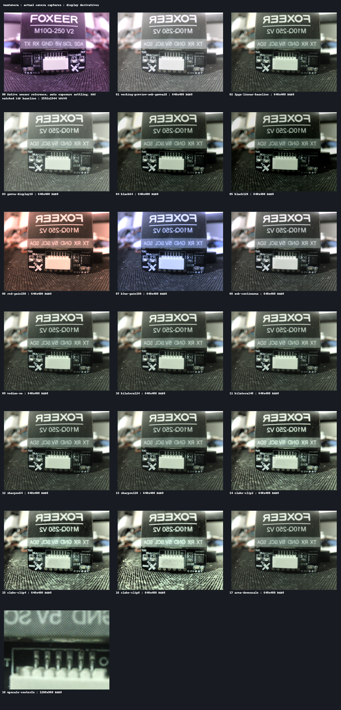

# Documentation

- [Project overview](../README.md), [hardware](../HW/README.md), [software](../SW/README.md)
- [Architecture](ARCHITECTURE.md), [ISP functions](ISP_FEATURES.md), [capabilities](ISP_CAPABILITIES.md)
- [Driver guides](drivers), [upscale](FPGA_UPSCALE.md), [remap controls](REMAP_CONTROL.md)
- [Adaptive tone](ADAPTIVE_TONE.md), [HDR experiment gate](HDR_EXPOSURE_EXPERIMENT.md)
- [Editable User Manual](manual-sources/manual.md), [editable Datasheet](manual-sources/datasheet.md)
- [Genuine image gallery](images/README.md), [capture manifest](images/manifest.json)
- [Verification and limits](VERIFICATION.md), [rights and notices](../RIGHTS.md)

The polished User Manual, Datasheet and Vivado Reports PDFs are designated
release attachments. They are not duplicated into Git source history. Editable
manual text and curated images remain here. Vendor board/camera PDF manuals,
rendered QA pages, scratch builds and raw photographs are excluded.

